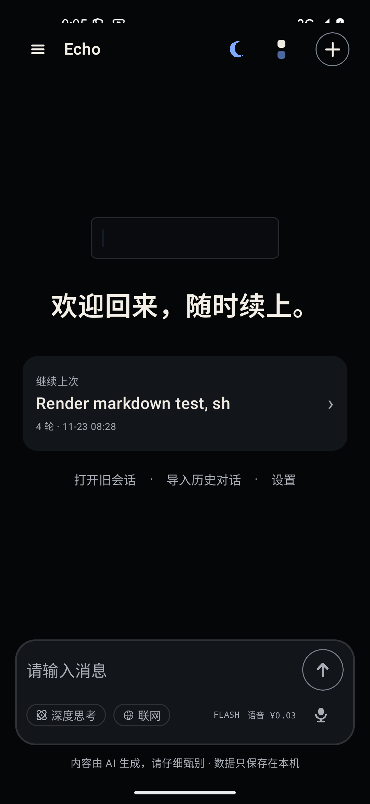
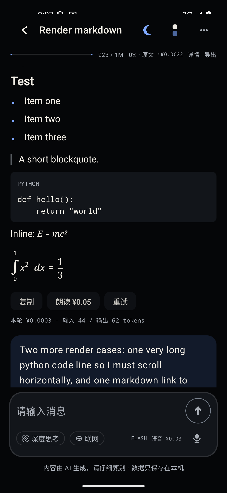
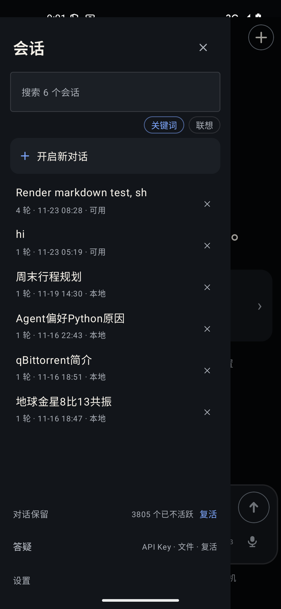
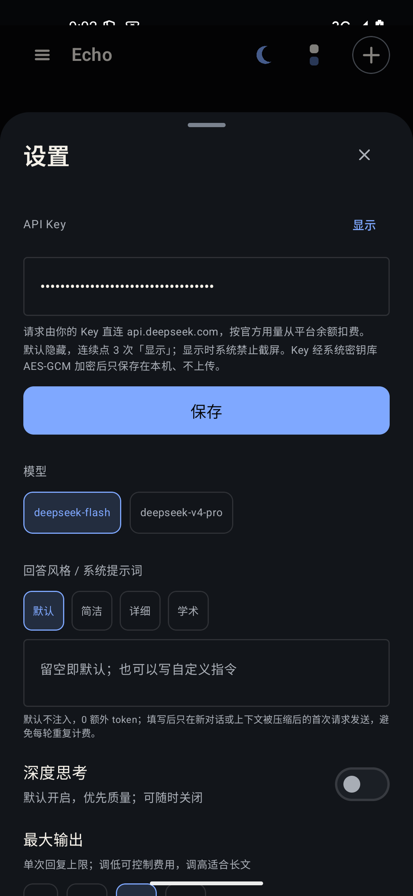
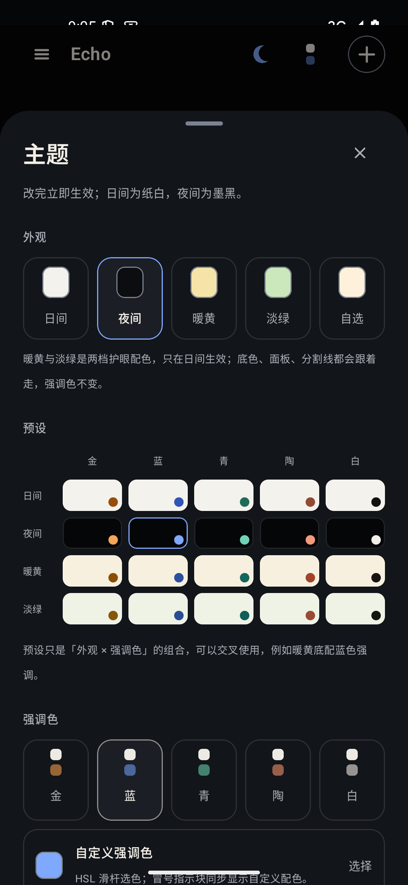
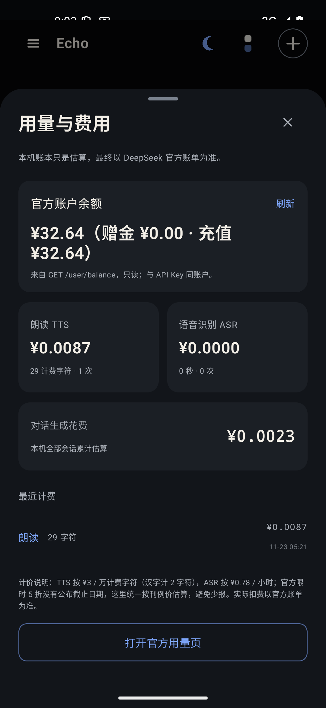
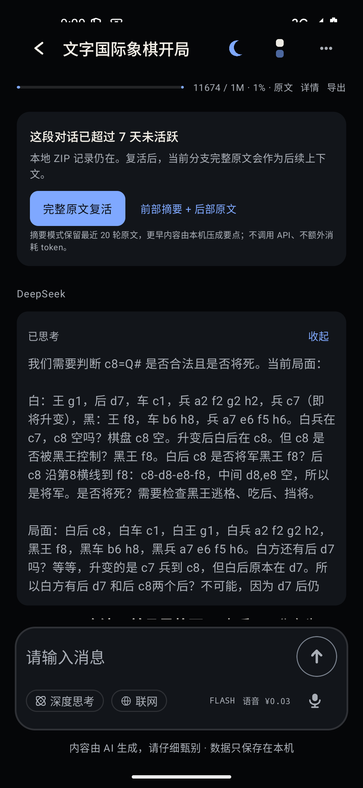
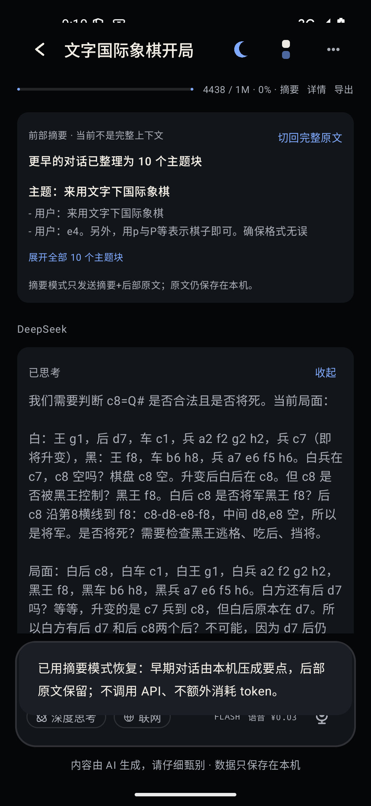

# Echo（回声）

一个原生 Android 客户端（Kotlin + Jetpack Compose）：把 DeepSeek 官方导出的历史会话 ZIP 导入本机，逐会话复活已超过 7 天未活跃的对话；对话直接走用户自己的 API Key（BYOK），不经过任何中转服务器。

> **版本 1.0.5（MIT 版） · versionCode 6** · 由 **DeepSeek-V4.1-Flash** 构建
> 第三方客户端，与 DeepSeek 官方无隶属关系；DeepSeek 名称与商标归其所有者。

## 免责声明与品牌边界

- **品牌资产不随代码授权**：Echo / 回声 的名称、图标与视觉识别保留所有权利，不在 MIT 范围内；未经书面许可，不得用它们标识或推广修改版、再分发包。
- **AI 辅助声明**：部分代码由 AI 辅助生成，按 **原样（AS IS）** 提供，不附带任何明示或暗示担保；使用风险自负。
- **免费与非商业**：本应用免费提供、不商业运营；代码以 MIT 许可发布，允许包括商业使用在内的任何用途，但须保留版权与许可声明。
- **维护边界**：不做云同步、账号系统、后端服务、广告、内购；不接入非公开接口；以“主题打磨”为主、不影响正确性与可用性的改动不在维护范围。
- 详见 [LICENSE](LICENSE) 与 [NOTICE](NOTICE)。

## 功能

- **历史导入**：读取官方导出的 chat_sessions/*.json，按 current_message_id → parent_id 还原当前分支；带气泡式导入向导与置顶答疑入口。
- **逐会话复活**：失效会话可选「完整原文」或「前部摘要 + 后部原文」；摘要由本机生成，不调用 API、不产生额外 token。
- **对话保留面板**：按时间 / 条数 / 总字数排序；长对话默认折叠。
- **导出**：会话页上下文条点「导出」，可把当前会话导成 Markdown，或把全部会话导成带 index.md 的 ZIP；走系统文件选择器，不申请存储权限。默认文件名会把半角逗号等不安全字符替换为「-」（如 `Echo-Render-markdown-test--sh-20261123-0848.md`），完成后提示「已导出 Markdown 文件」或「已导出 N 个会话的 ZIP」。
- **上下文透明**：显示当前 token / 1M、占比、原文或摘要模式，以及每轮与累计估算费用。
- **流式对话**：思考过程折叠；支持停止生成、重试、复制、朗读；单次输出上限默认 32K tokens，可在设置里选 8K / 16K / 32K / 64K，触顶会明确提示。
- **官方语音**：TTS 朗读（¥3 / 万计费字符）与语音识别（¥0.78 / 小时），调用前弹计费确认，可勾选不再提示；本机用量账本。朗读把官方 24 kHz 流在本机用半带 FIR 升采样到 48 kHz 输出，64 KB 播放缓冲避免缓冲超时静音。
- **联网搜索**：调用官方 deepseek_web_search 工具，回答附带来源链接。
- **外观**：日间 / 夜间 / 暖黄 / 淡绿四种外观 × 雾蓝 · 黛青 · 灰紫 · 陶土 · 沙金五种强调色（共 20 个预设，可交叉组合）；支持自定义 HSL 强调色；字号可调；切换有过渡动画。
- **隐私**：API Key 默认隐藏，连续点 3 次「显示」才展示，展示期间禁止截屏；Key 用 Android Keystore（AES-256-GCM）加密后才落盘，磁盘上没有明文；Key、会话与附件只存在本机。
- **自适应**：720–3840 像素宽度的屏幕均可正常使用；按钮尺寸与官方客户端对齐，关键操作经实测可点、相邻控件不误触。

## 截图

以下为实际运行截图（Android 模拟器，1080 × 2340，夜间外观 + 蓝强调色），未合成、未修饰；余额、费用与额度均为本机测试数据。

| | |
|---|---|
| **欢迎页**：最近一次会话、三个入口与输入区  | **对话页**：Markdown 标题 / 列表 / 引用 / 代码围栏，行内公式 E=mc²  |
| **会话抽屉**：关键词 / 联想搜索，现用与已失效会话分组，底部为对话保留与设置  | **设置**：官方 API Key（默认掩码）、模型、回答风格、最大输出  |
| **主题**：外观 × 强调色共 20 个预设，可交叉组合，并支持自定义 HSL 强调色  | **用量与费用**：官方余额、TTS / ASR / 对话估算与计价说明  |
| **失效会话复活**：超过 7 天的对话可选完整原文或「前部摘要 + 后部原文」  | **前部摘要 + 后部原文**：早期内容在本机压成主题块，后部原文保留，不调用 API  |

## 技术

纯原生，无 WebView、无自建后端、无第三方网络库（HttpURLConnection + 手写 SSE 解析）。29 个 Kotlin 文件、约 12,273 行：

    app/src/main/java/app/echo/
      MainActivity / EchoApp     入口与导航
      ChatScreen / MessageViews  对话流、消息与操作
      Composer / WelcomeScreen   输入区与欢迎页
      Drawer / SettingsScreen    会话抽屉、设置、关于
      HelpDialogs / UsageSheet   答疑、导入向导、计费确认、用量
      State / Models / Api / Sse 状态、持久化、流式请求、协议解析
      Billing / Speech / TtsAudio 计费、TTS、ASR、音频输出、用量账本
      Export                     导出引擎与会话页导出面板（单会话 Markdown / 全会话 ZIP）
      Design / Theme / Glyphs / Format / Motion

- namespace = applicationId = app.echo；旧包名 app.xuxie 已废弃，不得再使用。
- minSdk 26 / targetSdk 35。
- 版本号只有一个来源：gradle.properties 的 echo.versionCode / echo.versionName（当前 6 / 1.0.5）。
- 测试：JVM 单元测试 **132 例 0 失败**，覆盖请求体拼装与 SSE 解析/协议回归（`buildChatBody` / `pumpSse`）、计费与切分、格式化、导出渲染与 Markdown 解析（含流式切段扫描推进）、48k 半带重采样与播放尾等待（`TtsAudioTest`）、贴底跟随判定与发送回底纯函数（`FollowTailTest` 6 例）、落盘策略（`SessionPersistenceTest` 13 例：索引必写、加载门禁、脏标记代数、恢复对账顺序、墓碑剔除、坏索引合并与重复 id、启动清理门禁、墓碑合并与回滚、持久化过滤 persistableIds）、`TombstoneStoreTest` 6 例（墓碑文件损坏返回 null 且保留原文件、round-trip、并发 merge 保留磁盘墓碑、remove 保留其他、加载清理 merge 保留新增）；本地 `bash scripts/run_tests.sh --smoke` 会跑编译 + 单测 + mock SSE 自检 + 冒烟，命令与约定见 CONTRIBUTING.md；GitHub Actions 见 .github/workflows/ci.yml。
- 性能：流式正文按帧合并发布（Choreographer 帧回调，正常 / 性能模式分别 16 / 33ms 上限），对话页只在贴底且用户未上滑时跟随：新消息插入先按 `tailRescueIndex` 把尾项滚入视口，随后逐帧 `scrollBy`；Markdown 流式只在代码围栏 / 块级公式之外的空行或围栏闭合处提交稳定段并增量解析，末尾未闭合部分按全文纯文本渲染、不截断不隐藏（超过 2400 字符按 1200 字符分块，全文分块不切断代理对，流式稳定前缀边界落在高代理项之后会回退一格），稳定前缀按字符串缓存，未提交尾部只缓存已写满的 1200 字符块、每个 token 只重排最后一段增长尾部，完成后整体排版。会话列表的分区 / 搜索 / 排序结果按状态缓存；索引与快照的组装（`snapshotSession`）在主线程、序列化与写盘在 IO 线程，会话正文按需懒加载（≤48KB 快照在主线程同步解析；更大快照在 IO 线程完成 JSON→消息列表与摘要解析，主线程只发布结果，列表先用占位项渲染；正文未 ready 时发送 / 复活只提示稍候）。
- AOT（profile 引导）：release 内置官方 androidx.baselineprofile 插件生成的 **Baseline Profile**，并依赖 androidx.profileinstaller:1.4.1。Baseline Profile 只是“热点方法清单”，随同一个 APK 分发到所有设备；真正的机器码由每台设备安装/空闲时由 ART 的 dex2oat 以 speed-profile 本地生成，**不随安装包分发机器码**。

## 构建

需要 JDK 17、Android SDK 35（Gradle 8.9 由仓库内 wrapper 固定，首次运行时自动下载；也可直接用 Android Studio 打开本目录）：

    export JAVA_HOME=/path/to/jdk-17
    ./gradlew :app:assembleRelease -x lintVitalAnalyzeRelease -x lintVitalRelease

产物：app/build/outputs/apk/release/app-release.apk。默认 API：https://api.deepseek.com；如需指向本地 mock，可加 -PapiOrigin=http://10.0.2.2:18080（scripts/mock_sse_server.py，用法见 CONTRIBUTING.md）。不要用 mock 构建对外分发。

**正式签名**：release keystore 与口令**不入库**。在 GRADLE_USER_HOME/gradle.properties（例如 ~/.gradle/gradle.properties）配置：

    echo.release.storeFile=/absolute/path/echo-release.jks
    echo.release.storePassword=***
    echo.release.keyAlias=echo
    echo.release.keyPassword=***

没有这些配置时自动回退 debug 签名，仅适合本地内测。证书 SHA-256 指纹记录在 REVIEW.md。

**Baseline Profile** 的生成文件默认不提交（app/src/release/generated/ 已忽略）。需要重新生成时，先连一台 API 28+ 设备/模拟器，再构建 release：

    ./gradlew :app:generateBaselineProfile -x lintVitalAnalyzeRelease -x lintVitalRelease
    ./gradlew :app:assembleRelease -x lintVitalAnalyzeRelease -x lintVitalRelease

profile 由 baselineprofile 宏基准模块采集，覆盖启动、滚动、设置、会话搜索等主要路径。

## 隐私与费用

- 会话、附件、API Key 全部保存在本机；卸载即删除。
- 对话、朗读、语音识别的费用由你的 API Key 直接支付给 DeepSeek，本应用不预扣、不代收、不额外加价。
- 应用内金额为按官方公开价估算，以官方账单为准。

## 已知限制

- Markdown/LaTeX 由自研 `Markdown.kt` 渲染，属手写子集：不支持表格、图片、嵌套列表；块级公式有布局开销。流式过程中最后一个未闭合段以纯文本尾行渲染，回答完成后整体按 Markdown 排版。
- 导入只保留当前分支；官方导出不含附件二进制，图片与文件不会重传；按会话 id 去重合并（同 id 保留本机版本）。
- 全会话 ZIP 导出无进度条、不可取消（实测 < 10 s）；单会话导出整份 JSON 解析，存在内存峰值。
- 联网搜索真实 Key 全链路已于 2026-11-23 打通（回答末尾的来源引用可正常渲染）；CI 工作流已于 2026-11-24 在 GitHub 实跑通过（run 45256129908，JVM 测试 job 3m8s：Kotlin 编译 + 132 单测 + mock SSE 自检）。
- 视觉与交互以主题打磨为主；附件重传、多端同步等能力见 docs/not-doing.md 与路线图。

## 未做（1.0.6 待办）

- **沙金强调色增亮**：日间 `#7F6726` / 夜间 `#B4974C` 在预设面板与界面中偏暗褐，观感不佳；1.0.6 提亮沙金并同步 COLOR-V3 规范与预设面板 swatch。来源：用户反馈（2026-11-23），当前 1.0.5 版本冻结，不在本版改动。

## 文档

- [ARCHITECTURE.md](ARCHITECTURE.md)：模块、线程、持久化与一次发送的链路。
- [docs/protocol-compat.md](docs/protocol-compat.md)：上游接口、SSE 事件、错误码与已知不兼容。
- [CONTRIBUTING.md](CONTRIBUTING.md)：构建、测试、代码风格与 PR 规范。
- [docs/not-doing.md](docs/not-doing.md)：明确不做与维护边界。

## 许可

- 代码：MIT（见 LICENSE）。
- 第三方依赖归属：NOTICE（Compose / Kotlin / AndroidX 等，Apache-2.0）。
- 名称、图标与视觉资产：保留所有权利，不随 MIT 授权。

## 数据

本仓库不包含任何用户会话、附件或 API Key。
